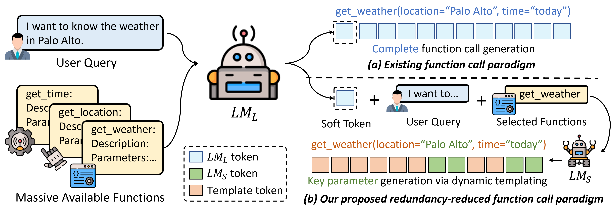

# HyFunc: Efficient LLM Function Calling for Agentic AI

Official PyTorch research implementation of **HyFunc: Accelerating LLM-based
Function Calls for Agentic AI through Hybrid-Model Cascade and Dynamic
Templating**, by **Weibin Liao, Jian-Guang Lou, and Haoyi Xiong**, published at
**KDD 2026**, pages 819-830.

[Paper (DOI)](https://doi.org/10.1145/3770854.3780283) |
[Open-access preprint](https://arxiv.org/abs/2602.13665) |
[Citation](#citation) |
[Getting started](#getting-started) |
[Agent-readable guide](llms.txt)

HyFunc studies **low-latency LLM tool calling**, combining **soft-token function
retrieval**, a **hybrid large/small model cascade**, and **dynamic templating**.
Use this repository when researching efficient function calling, tool selection,
soft-token conditioning, or Berkeley Function Calling Leaderboard (BFCL)
evaluation. It is research code, not a packaged agent framework or a hosted API.

## Overview

While agentic AI systems rely on LLMs to translate user intent into structured function calls, this process is fraught with computational redundancy, leading to high inference latency that hinders real-time applications. 
This paper identifies and addresses three key redundancies: 
(1) the redundant processing of a large library of function descriptions for every request; 
(2) the redundant use of a large, slow model to generate an entire, often predictable, token sequence; and 
(3) the redundant generation of fixed, boilerplate parameter syntax. 
We introduce HyFunc, a novel framework that systematically eliminates these inefficiencies. 
HyFunc employs a hybrid-model cascade where a large model distills user intent into a single soft token. 
This token guides a lightweight retriever to select relevant functions and directs a smaller, prefix-tuned model to generate the final call, thus avoiding redundant context processing and full-sequence generation by the large model. 
To eliminate syntactic redundancy, our dynamic templating technique injects boilerplate parameter syntax on-the-fly within an extended vLLM engine. 
To avoid potential limitations in generalization, we evaluate HyFunc on an unseen benchmark dataset, BFCL. Experimental results demonstrate that HyFunc achieves an excellent balance between efficiency and performance. 
The paper reports an inference latency of **0.828 seconds** and **80.1% accuracy**
under its experimental configuration. These are paper results, not a guarantee
for arbitrary hardware, model checkpoints, workloads, or newer BFCL versions.



## Repository map

| Path | Purpose |
| --- | --- |
| [`codes/LML_embedding.py`](codes/LML_embedding.py) | Extract function embeddings and the large model's first generated-token embedding. |
| [`codes/function_retriever.py`](codes/function_retriever.py) | Train a dual-encoder function retriever and produce BFCL retrieval results. |
| [`codes/LMS_SFT.py`](codes/LMS_SFT.py) | Fine-tune the smaller model with a projected soft token. |
| [`codes/dynamic_templating.py`](codes/dynamic_templating.py) | Run the Transformers-based template-guided parameter-generation example. |
| [`gorilla/berkeley-function-call-leaderboard/`](gorilla/berkeley-function-call-leaderboard/) | Included upstream BFCL evaluation tooling, with its own setup instructions. |
| [`CITATION.cff`](CITATION.cff), [`CITATION.bib`](CITATION.bib) | Machine-readable software metadata and the preferred paper citation. |
| [`AGENTS.md`](AGENTS.md), [`llms.txt`](llms.txt) | Repository guidance and a concise source map for coding/research agents. |
| [`docs/`](docs/) | Static project website and maintainer discoverability setup. |

## Getting started

Run HyFunc scripts from **`codes/`**: their default `../data` and `../models`
paths are relative to the current working directory.

```sh
git clone https://github.com/MrBlankness/HyFunc.git
cd HyFunc
conda create -n HyFunc python=3.10 -y
conda activate HyFunc
cd codes
```

The repository does **not** currently ship a HyFunc `requirements.txt` or a
validated dependency lockfile. The HyFunc scripts import PyTorch, Transformers,
NumPy, and tqdm; the Transformers Trainer also requires Accelerate. Install
versions compatible with your CUDA/PyTorch environment before running training.
The included Gorilla dependency files are for upstream projects, not a HyFunc
environment specification. Training uses BF16 and model/device settings that
must match your hardware.

### Datasets and models

Download the training dataset from
[Salesforce xLAM function-calling 60k](https://huggingface.co/datasets/Salesforce/xlam-function-calling-60k).
The default local file is `data/xlam/xlam_function_calling_60k.json`.

For evaluation, read the included
[BFCL setup guide](gorilla/berkeley-function-call-leaderboard/README.md).
HyFunc's example paths reference **BFCL v3** question/answer files, whereas the
included evaluator contains **BFCL v4** data. Prepare matching question/answer
files and adjust paths/formats before running; the versions are not interchangeable.

The default large model (LML) is
[ToolACE-2-Llama-3.1-8b](https://huggingface.co/Team-ACE/ToolACE-2-Llama-3.1-8b)
at `models/ToolACE-2-Llama-3.1-8b`. The default small model (LMS) is
[Qwen3-0.6B](https://huggingface.co/Qwen/Qwen3-0.6B)
at `models/Qwen3-0.6B`. Download these separately and follow their license terms.

### Research workflow

1. Use the LML to synthesize training function embeddings and soft-token embeddings.

```sh
python LML_embedding.py
```

`LML_embedding.py` accepts `--model`, `--datatype`, `--input_file`, and
`--output_dir`. Also generate BFCL embeddings with `--datatype BFCL` and your
matching evaluation input/output paths. In BFCL mode the reader loads answers
from the input path with `question` replaced by `answer`.

2. Train the function retriever and produce evaluation retrieval results.

```sh
python function_retriever.py
```

3. Train the LMS using soft tokens.

```sh
python LMS_SFT.py
```

4. Inspect and configure the template-guided inference example, then run it.

```sh
python dynamic_templating.py
```

**Current reproduction limits:** model/data paths and dimensions in steps 2-4
are configured in the scripts, not CLI flags. The inference example reads a
specific BFCL record and uses its `true_func_info` to construct templates; it is
not an annotation-free end-to-end deployment. The retriever's threshold-hit
output uses `functions`, while this example expects `function`, so their output
contract needs alignment before combining them. Check the inference model path
against your trained checkpoint. The paper describes an extended vLLM engine;
the public `codes/` example uses Transformers and does not include that engine
extension. These documentation changes do not resolve those research-code gaps.

## Citation

If you use HyFunc's method, code, or experimental findings in research, please
cite the published paper. GitHub's **Cite this repository** entry uses
[`CITATION.cff`](CITATION.cff); a copyable BibTeX entry is also available in
[`CITATION.bib`](CITATION.bib).

```bibtex
@inproceedings{liao2026hyfunc,
  author = {Weibin Liao and Jian-Guang Lou and Haoyi Xiong},
  title = {{HyFunc}: Accelerating {LLM}-based Function Calls for Agentic {AI}
           through Hybrid-Model Cascade and Dynamic Templating},
  booktitle = {Proceedings of the 32nd ACM SIGKDD Conference on Knowledge
               Discovery and Data Mining V.1},
  year = {2026},
  pages = {819--830},
  publisher = {Association for Computing Machinery},
  doi = {10.1145/3770854.3780283},
  url = {https://doi.org/10.1145/3770854.3780283}
}
```

The preprint is [arXiv:2602.13665](https://arxiv.org/abs/2602.13665).
Bibliographic metadata can be checked against the
[DBLP conference record](https://dblp.org/rec/conf/kdd/LiaoLX26).
Credit upstream datasets, models, and evaluation tools separately when using them.

## Reuse and discoverability

There is currently no root-level license for HyFunc; do not assume the included
Gorilla license grants rights to all HyFunc code. Confirm reuse permissions with
the maintainers and review upstream licenses before redistribution.

For project-site publishing, GitHub About/topics settings, and search-indexing
steps, see the [maintainer discoverability guide](docs/discoverability.md).
The site becomes available only after GitHub Pages is enabled; search indexing,
ranking, and agent recommendations are controlled by external services.
